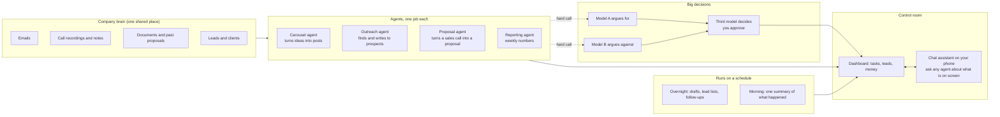

# AI company map

One page that shows how a small business can run on AI agents: what each agent does, the one place they all read from, where you watch them, and what runs while you sleep.

This is the map behind the reel "This is what it looks like when AI agents run a company". It is the shape of a real one-person setup, written so you can copy it for your own business.

## The parts

| Part | What it is | What you still do |
|---|---|---|
| Company brain | Every email, call and document in one place the agents can search | Decide what goes in and what stays private |
| Agents | One agent per job, each with a short written brief | Approve anything that goes to a customer |
| Control room | One dashboard with every task, lead and invoice, plus a chat assistant you can ask about any of it | Check it once a day |
| Schedule | Jobs that run overnight and a short morning summary | Read the summary |
| Big calls | Two models argue opposite sides, a third weighs them | Make the final call |

## Rules that keep it safe

- Agents draft, people send. Nothing goes to a customer without a human yes.
- One brief per agent, one job per brief. A vague agent does vague work.
- Keys and passwords stay in the tool settings, never in a prompt or a document.
- Start with the one job that eats most of your week. Add the next agent only when the first one works.

## Draw your own

Paste this into Claude:

> Help me design a map of how AI agents could run my business. My business is [what you do]. List the 5 jobs that eat most of my week. For each job, name one agent that would do it, what it reads from, what it hands off, and what I must still approve. Then draw the whole thing as one page: the agents, one shared place they all read from (my emails, calls and documents), one dashboard where I see what each agent did, and a schedule of what runs while I am away. Keep it to what I could set up in a month.

## License

MIT. Copy it, change it, use it for your own business.
